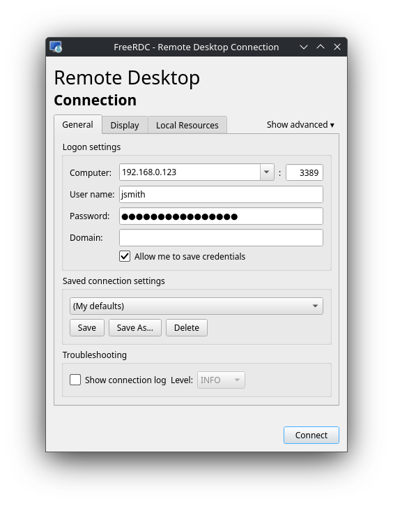
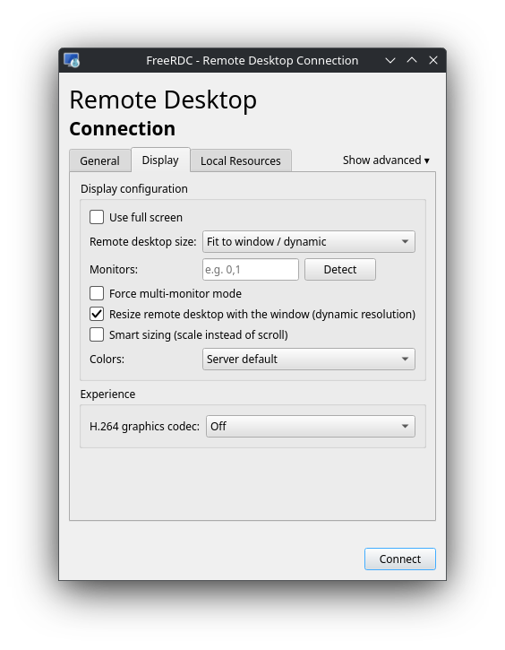
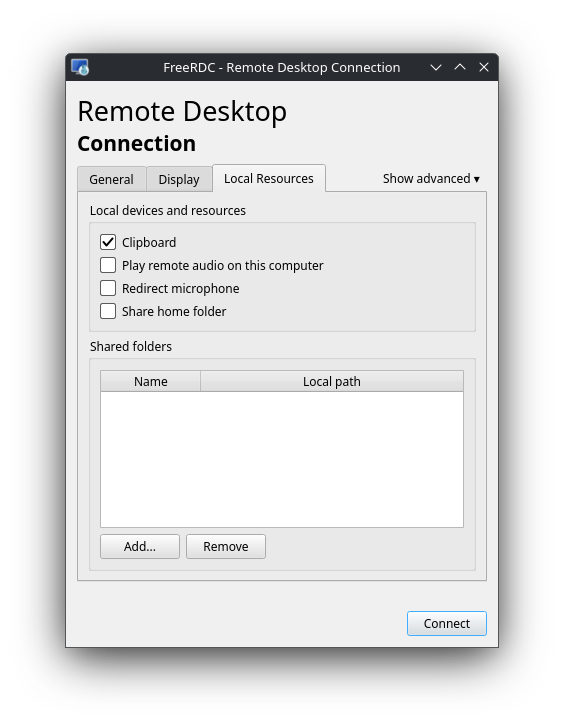
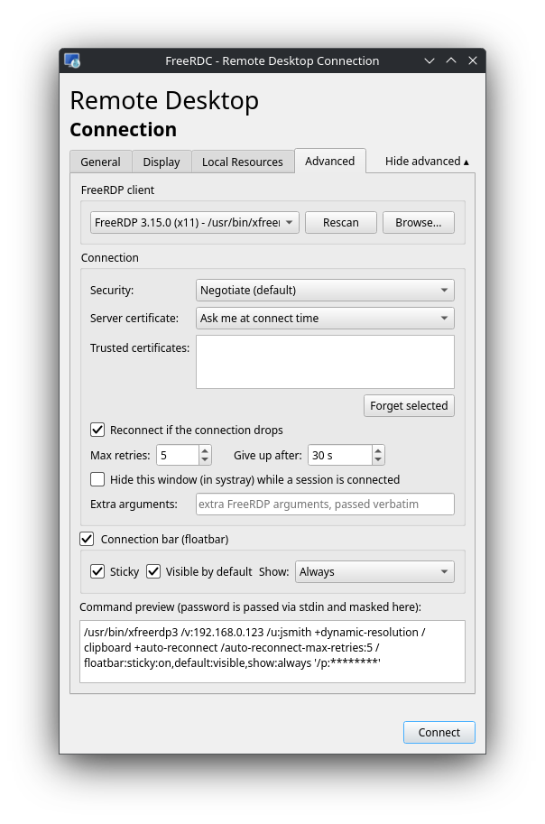

# FreeRDC

The FreeRDP UI wrapper that will make switching to linux easier.

This application is a Linux desktop front end for [FreeRDP](https://www.freerdp.com/), styled after the Windows 10 *Remote Desktop Connection* dialog. 

Built with Python (3.13) and PySide6 (Qt 6), packaged with PyInstaller.

It runs the FreeRDP client you choose (2.x or 3.x; X11, Wayland or SDL) and builds the command line for you.

## Features

- **Works with FreeRDP 2 and 3.** Finds every installed client and lets you pick one. It hides the
  differences between versions (clipboard, H.264, password handling, certificate options) and leaves out
  options a client doesn't support. X11 clients are preferred by default.
- **Familiar layout.** General, Display and Local Resources tabs, plus an Advanced tab you can show or hide.
- **Display.** Fullscreen or a chosen size, colour depth, smart sizing, dynamic resolution, multiple
  monitors with a Detect button, H.264/AVC444.
- **Local resources.** Clipboard, sound, microphone, shared folders, home drive.
- **Advanced.** Security protocol, auto-reconnect, floating connection bar, extra arguments and a command preview.
- **Saved connections and "(My defaults)".** Save named connections, or save your own default options that every new connection (new app start) begins with from.
- **Credentials.** Remembers recent servers like the Windows client. Passwords are only saved if you tick
  "Allow me to save credentials", and then go to the OS system keyring (Secret Service), never to a file.
- **Server certificates.** Asked about in the GUI instead of hanging on a console prompt. You can choose to ask each time, trust only saved certificates, or accept any. Trusted certificates are kept per server.
- **Clear errors and status.** Wrong password, unreachable host, certificate problems and so on appear as plain-language dialogs. A status line shows the connect time, with a configurable timeout and a Cancel button.
- **Connection log.** An optional live FreeRDP log panel with a log level setting.
- **Systray.** Optionally hides the connection dialog window once a session is successfully connected.
- **Same look everywhere.** A fixed light Fusion theme, whatever the desktop theme.
- **Settings & Profiles** All settings and profiles are stored in `~/.config/freerdc/` so they can be easily backed up or copied.

## Prerequisites

Needs at least one FreeRDP client (`freerdp2-x11` or `freerdp3-x11`; `freerdp3-sdl` optional).

## Install a release download

1. Install a FreeRDP client (see above). On a minimal system also install the OpenGL libraries
   (Debian/Ubuntu/Mint: `libegl1 libgl1`; Fedora: `mesa-libEGL mesa-libGL`). A normal desktop already has them.
2. Unpack the release somewhere permanent, for example:

       mkdir -p ~/.local/opt && tar -xzf freerdc-*.tar.gz -C ~/.local/opt

   (A single-file release is just the `freerdc` file: put it where it will stay and run `chmod +x freerdc`.)
3. Add it to your start menu / application launcher, with its icon, by running the program once with
   `--install-desktop`:

       ~/.local/opt/freerdc/freerdc --install-desktop

   FreeRDC then appears in your applications (Network / Internet). If it doesn't show up straight away, log out and in again.
   The menu entry points at the place you installed it, so run this command again if you move the program.
4. To remove the menu entry: `~/.local/opt/freerdc/freerdc --uninstall-desktop`. Your settings stay in `~/.config/freerdc/`.

You can also just start it directly with `~/.local/opt/freerdc/freerdc`.

## Run from source

    python3 -m venv .venv && .venv/bin/pip install -r requirements.txt

    .venv/bin/python -m freerdc

## Package

Two ways to build the bundle (a folder you can copy to other machines and run with `freerdc`):

    packaging/build-in-docker.sh    # in a Ubuntu 22.04 container -> dist-docker/freerdc/
    packaging/build-native.sh       # on this machine, no Docker   -> dist-native/freerdc/

Both scripts build a **folder** by default (starts fast; copy the whole folder). For a **single executable
file** instead, set `MODE=onefile` in front of either script:

    MODE=onefile packaging/build-in-docker.sh    # -> dist-docker/freerdc    (one file)
    MODE=onefile packaging/build-native.sh       # -> dist-native/freerdc    (one file)

The single file is easier to hand out but starts more slowly, because it unpacks itself on every launch.

The Docker build is the one to use for sharing: it runs on Ubuntu 22+, Debian 12+,
Mint 22+ and current Fedora (x86-64). A native build contains this machine's libraries, so it only runs
on the same distro version or newer. It needs `python3` with `venv` (Debian/Ubuntu: `python3-venv`).

To add a program you built to your start menu, run it once with `--install-desktop` (see
[Install a release download](#install-a-release-download); it works the same for both build modes).

See [packaging/README.md](packaging/README.md) for what the target machine needs and what was tested.

## Tests

After the setup under "Run from source", run the unit tests from the project folder:

    .venv/bin/python -m unittest discover -s tests

They need no RDP server or screen (Qt runs offscreen and the keyring is faked) and take about 20 seconds.
Check an installation, and optionally make real connections:

    freerdc --self-test    # environment check; real connections with FREERDC_TEST_HOST/USER/PASSWORD

## License

FreeRDC is released under the [MIT License](LICENSE). It uses Qt/PySide6 (LGPL-3.0) and other open-source
components, and runs your installed FreeRDP (Apache-2.0) as a separate program; see
[THIRD_PARTY_NOTICES.md](THIRD_PARTY_NOTICES.md). FreeRDC is not affiliated with the FreeRDP project or Microsoft.

## Screenshots

